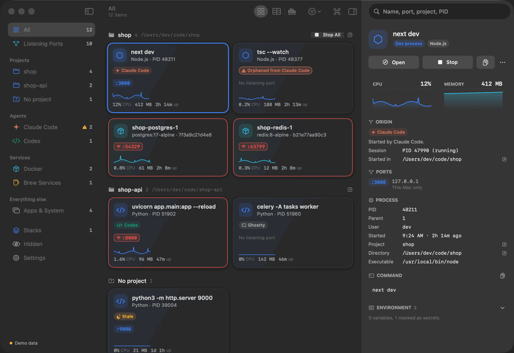
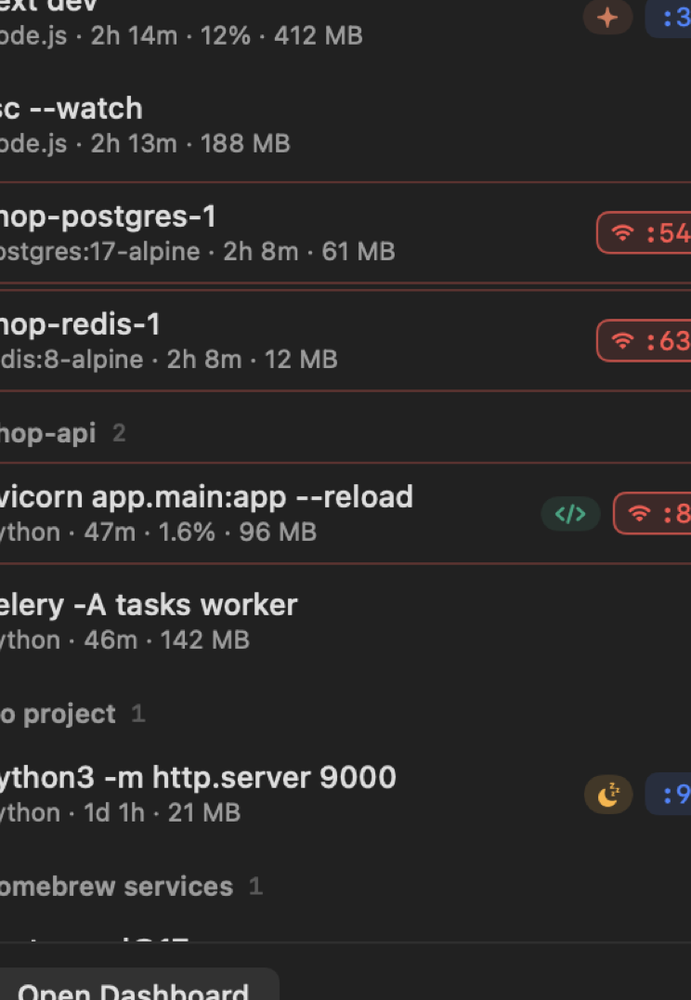
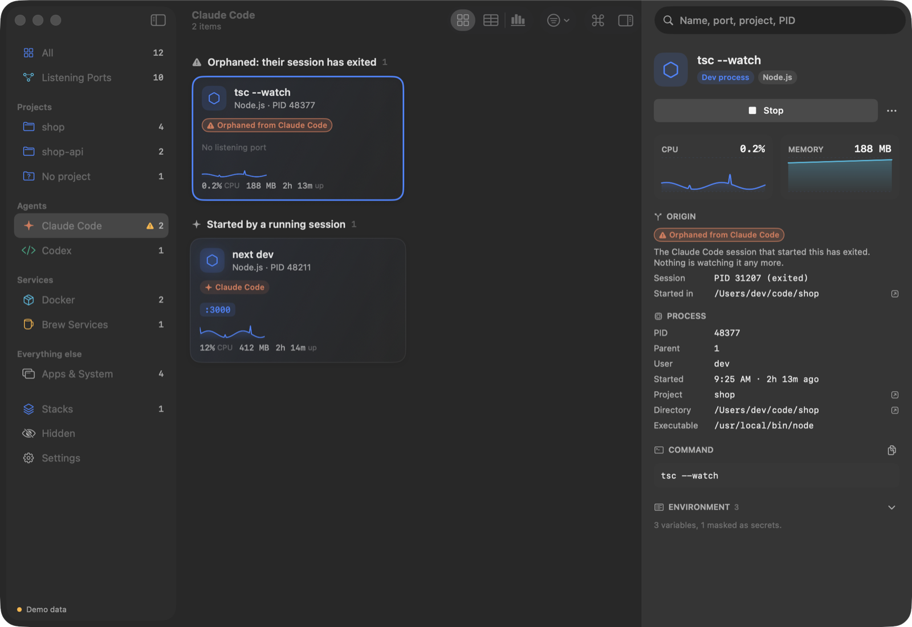
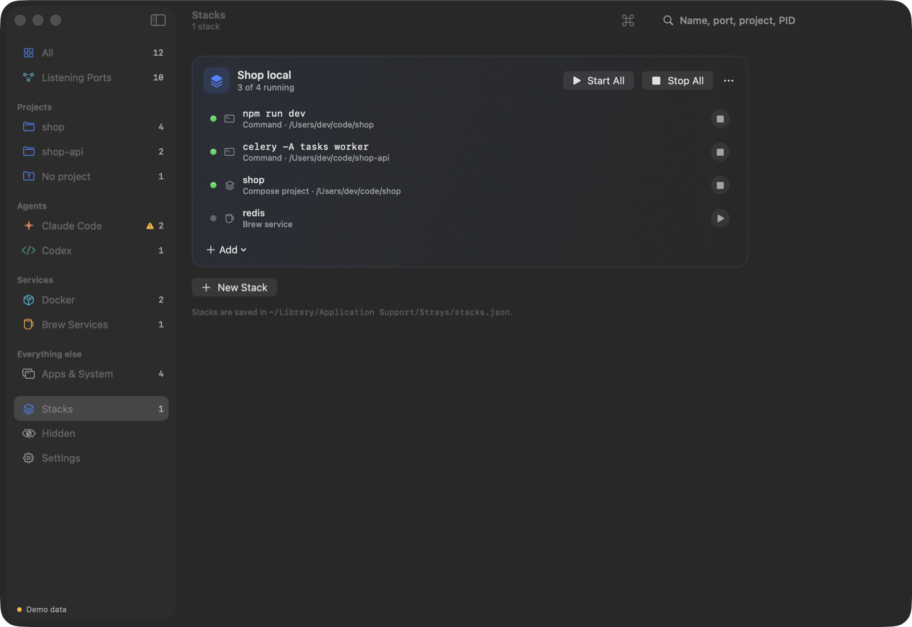

<p align="center">
  
</p>

<h1 align="center">Strays</h1>

<p align="center">
  See everything running in the background on your Mac, and stop it in one click.<br>
  Listening ports, dev servers, Docker containers, Homebrew services,<br>
  and the processes your AI coding agents left behind.
</p>

<p align="center">
  
</p>

You start a dev server, forget it, and three days later something is still
holding port 3000. Or an AI coding agent starts a watcher in the background,
the session ends, and the watcher keeps running with nobody watching it.
Strays is a free, open-source menu bar app that shows all of it and lets you
deal with it.

- **Native.** Swift and SwiftUI, an 11 MB universal app, no Electron.
- **Light.** About 0.35% of one core and 17 MB of memory while it sits in the menu bar.
- **Safe.** It never asks for your password, never escalates, and re-checks that a PID is still the same process before it signals it.
- **Private.** No telemetry. The only network request is an optional daily check for a new release.

Requires macOS 14 Sonoma or later, on Apple Silicon or Intel.

## Install

```bash
brew install --cask suryavmds/tap/strays
```

Or download `Strays.zip` from the [latest release](https://github.com/suryavmds/strays/releases/latest),
unzip it, and drag `Strays.app` to Applications. Releases are signed with a
Developer ID and notarized by Apple, so it opens like any other app.

Strays lives in the menu bar. Click the paw to see what is running; choose
**Open Dashboard** for the full window.

## What it shows



**Listening ports.** Every TCP port in LISTEN state and who owns it, read
straight from the kernel. A port bound to `0.0.0.0` or `::` is reachable from
your network, and gets a red outline so you notice.

**Dev processes without a port.** Watchers, workers, queue consumers,
`tsc --watch`: anything running a known runtime (Node, Bun, Deno, Python, Ruby,
Go, Rust, JVM, PHP, and more) from inside your home folder.

**Docker containers.** Running and stopped, grouped by compose project, with
their published ports. Start, stop, restart, remove, read the last 200 log
lines, or stop a whole compose project. Strays talks to the Docker Engine API
directly and looks for the socket of Docker Desktop, OrbStack, Colima, and
Rancher Desktop (tested with Docker Desktop).

**Homebrew services.** Redis, Postgres, and whatever else `brew services`
manages, with start, stop, and restart.

**Projects.** Everything is grouped by the project it belongs to, found by
walking up from the working directory to the nearest `.git`, `package.json`,
`pyproject.toml`, `Cargo.toml`, `go.mod`, `Gemfile`, `composer.json`, or
compose file.

**A process tree is one thing.** `npm run dev`, the shell it spawned, and the
server that shell started show up once, as `npm run dev`, with the tree's
total CPU and memory. Stopping it stops the tree.

<br clear="right">

## AI agents



Strays tells you which AI coding agent started a process, and, more to the
point, which processes an agent **left behind**.

A process is attributed to an agent in one of two ways:

1. **By ancestry.** Walking up the chain of parent processes finds the agent.
   The nearest agent wins.
2. **By environment.** Agents set marker variables in the shells they spawn.
   When a process has been detached from its agent, the parent chain is gone
   and the marker is all that is left.

When only the environment matches and the agent session that started the
process has exited, Strays labels it **Orphaned from _agent_**. These are the
ones most worth knowing about: nothing is watching them any more.

| Agent | Sessions that are running | Orphans, after the session exits | Environment markers |
|---|---|---|---|
| Claude Code | Yes | **Yes** | `CLAUDECODE=1`, `AI_AGENT=claude-code…`, session PID in `CLAUDE_PID`. Verified 2026-10-12 on 2.1.283 (CLI) and 2.1.295 (desktop app). |
| OpenAI Codex CLI | Yes | Not yet | None verified |
| Gemini CLI | Yes | Not yet | None verified |
| Aider | Yes | Not yet | None verified |
| Cursor Agent (`cursor-agent`) | Yes | Not yet | None verified |

"Not yet" is deliberate. Strays only matches on a marker that someone has
actually observed in a background process started by that agent; a guessed
marker would attribute things wrongly. If you use one of these agents,
verifying its marker takes two minutes and a pull request that touches a
single JSON file: see [CONTRIBUTING.md](CONTRIBUTING.md#adding-or-verifying-an-agent).

Processes started from the agent built into the Cursor editor are reported as
started from the Cursor IDE: they run through the same helper processes as a
terminal you opened yourself, and nothing verified tells the two apart.

A process no agent started still gets an origin: the terminal (Terminal,
iTerm2, Ghostty, Warp, kitty, WezTerm, tmux…) or IDE (VS Code, Cursor, Zed,
JetBrains, Xcode…) among its ancestors, or **Unknown origin**. Nothing is
hidden for lack of one.

You can add or override profiles without rebuilding by putting an
`agents.json` of the same shape in `~/Library/Application Support/Strays/`.

### One macOS limit

Recent versions of macOS may not reveal the environment of Apple's own system
binaries (`/bin/zsh`, `/usr/bin/ruby`, and so on), even to the same user. This
was observed on macOS 26; a macOS 15 machine did reveal it. Where it is
hidden, an orphan running one of those can only be attributed while its agent
is still its ancestor. Node, Python, Bun, and other third-party runtimes are
unaffected.

## Why not just `lsof`?

`lsof -iTCP -sTCP:LISTEN` answers one question: what is listening. It is the
right tool for that, and Strays falls back to it if the kernel API fails. But:

- It lists **processes, not things.** A dev server is npm, a shell, and node;
  `lsof` shows you the leaf, with a truncated name, and no idea what project
  it belongs to.
- It **misses everything without a port**: the watcher, the worker, the queue
  consumer that an agent started and forgot.
- It **cannot see root's listeners** without `sudo`. Strays reads those from
  `netstat`, which reports the owning PID unprivileged.
- It does not know about **containers**. A published port belongs to Docker's
  helper process as far as `lsof` is concerned.
- It tells you nothing about **who started it**, **how long it has idled**, or
  whether stopping PID 48211 is safe.
- And then you still have to `kill` it, and hope the PID has not been reused.

## Stopping things safely

- **Stop** sends SIGTERM and waits up to five seconds. If the process is
  still there, Strays offers **Force Kill** rather than doing it for you.
- Before any signal, Strays checks that the PID still has the start time it
  recorded. PIDs are reused; this is how it never kills the wrong process.
- It refuses outright to signal PID 0 or 1, itself, WindowServer,
  loginwindow, and the other processes that keep your session alive.
- For a process that belongs to root or another user, it does not ask for
  your password. It offers the `sudo kill` command to copy instead.
- Stopping an app, or one of macOS's own daemons, asks first.
- Containers and Homebrew services are stopped through Docker and `brew`,
  never by signal, and the confirmation toast offers **Start Again**.

## More



**Stacks.** Group what one project needs (a shell command and its folder, a
compose project, a Homebrew service, a container) and start or stop the lot
in one click. Stacks are plain JSON in
`~/Library/Application Support/Strays/stacks.json`.

**Stale detection.** Something running for more than six hours that has done
nothing for the last half hour is flagged as stale. Notifications are opt-in,
default to one summary a day, and come with Stop and Snooze.

**Hide rules.** Hide by port, by name, or a whole project, from any context
menu. Hidden things are left out of the count and never notify.

**Views.** Cards, a sortable table, and a timeline of when each thing started
today. Search by name, port, project, or PID. Press <kbd>⌘K</kbd> for a
command palette that can do everything the window can.

**Inspector.** The full command line, the environment with secrets masked,
the process tree, every port and what it is bound to, and live CPU and memory.

## Permissions and privacy

Strays is not sandboxed: it has to inspect other processes, send signals, and
talk to the Docker socket. It is distributed outside the Mac App Store for
that reason. What it does with that:

- **No password, ever.** It runs as you and can only do what you can.
- **No telemetry.** The one network request is to GitHub's public API, once a
  day, to see whether a newer release exists. It sends nothing about your
  Mac, and you can turn it off in Settings.
- **No surprise prompts.** Reading a project's `package.json` for its name
  would make macOS ask for access to Documents, Desktop, or Downloads. By
  default Strays does not read file contents there and uses the folder name
  instead. You can allow it in Settings.
- **Stacks run commands as you.** If a stack starts a command in a folder
  macOS protects, macOS will ask whether Strays may access that folder, the
  same way it asks about a terminal.
- **Secrets are masked.** Environment variables and arguments that look like
  keys, tokens, secrets, or passwords are hidden until you choose to reveal
  them, as are credentials embedded in URLs.

## Command line

The same engine is available as a small command-line tool:

```bash
swift run --package-path strays-cli strays            # what you left running
swift run --package-path strays-cli strays --all      # plus apps, system daemons, stopped things
swift run --package-path strays-cli strays inspect 48211   # where one process came from
swift run --package-path strays-cli strays agents     # the agent profiles Strays knows
```

## Building from source

```bash
brew install xcodegen
make build   # generate the Xcode project and build Strays.app
make test    # run the StraysCore unit tests
make run     # build and launch; look for the paw in the menu bar
```

You need Xcode 16 or later. The Xcode project is generated from `project.yml`
and is not committed.

`StraysCore/` is a Swift package with all data collection, models, and
actions, and no UI. `Strays/` is the SwiftUI app. `strays-cli/` is the
command-line tool. Tests that touch the real machine start their own throwaway
processes and clean them up; they never touch anything they did not start.

The dissolve animation is a Metal shader. Since Xcode 26 the Metal compiler is
a separate download; without it the app builds fine and uses a non-shader
fallback. To build with the shader: `xcodebuild -downloadComponent MetalToolchain`.

## Contributing

Bug reports, agent profiles, and pull requests are welcome. Start with
[CONTRIBUTING.md](CONTRIBUTING.md).

## License

[MIT](LICENSE)
